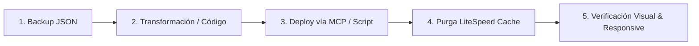

# 🌲 Lastras de Cuéllar — Portal Web & Sistema Editorial

> **Portal oficial y divulgativo de Lastras de Cuéllar (Segovia)**  
> Producción: [https://www.lastrasdecuellar.net](https://www.lastrasdecuellar.net)  
> Stack: WordPress 6.x + Elementor Pro + LiteSpeed Cache + MCP Automation Suite

---

## 📚 Índice de Documentación del Proyecto

| Documento | Audiencia / Propósito |
|---|---|
| [README.md](file:///Users/miguelangelmatarranzsanchez/Desktop/aplicaciones-web/LastrasDeCuellar/README.md) | Visión general del proyecto, inventario de IDs y arquitectura global |
| [AGENTS.md](file:///Users/miguelangelmatarranzsanchez/Desktop/aplicaciones-web/LastrasDeCuellar/AGENTS.md) | **Manual operativo obligatorio para agentes de IA** (reglas duras, serialización Elementor, purga de caché, backups) |
| [DESIGN_SYSTEM.md](file:///Users/miguelangelmatarranzsanchez/Desktop/aplicaciones-web/LastrasDeCuellar/DESIGN_SYSTEM.md) | **Biblia de diseño visual**: Tokens, Google Fonts (`Playfair`, `Cinzel`, `Plus Jakarta Sans`), Bento Cards y clases CSS |

---

## 🤖 Guía Rápida para Agentes de IA (Agent Memory & Protocols)

Este repositorio actúa como el **centro de operaciones de diseño, desarrollo y automatización con agentes de IA** sobre la plataforma WordPress/Elementor de *Lastras de Cuéllar*.

Cualquier agente de IA que opere en este entorno **debe consultar previamente [AGENTS.md](file:///Users/miguelangelmatarranzsanchez/Desktop/aplicaciones-web/LastrasDeCuellar/AGENTS.md)** antes de realizar cualquier mutación.

---

## 🏛️ 1. Arquitectura y Conectividad

- **Servidor MCP Activo**: `lastras-de-cuellar-segovia-elementor`
- **Endpoint MCP**: `https://www.lastrasdecuellar.net/wp-json/mcp/mcp-adapter-default-server`
- **Configuración de agentes**: Localizada en `.agents/mcp_config.json`.
- **Integraciones visuales**:
  - `stitch` (Google Stitch): Prototipado rápido de componentes e interfaces limpias.
  - Scripts en Python con manipulación del árbol de nodos de Elementor (`_elementor_data`).
  - Playwright / Scripts headless para auditoría visual y verificación móvil.

---

## 🎨 2. Sistema de Diseño (Design Tokens & UI Guidelines)

La identidad visual del portal combina la tradición segoviana, la naturaleza (tierra de pinares y resina) y un diseño moderno tipo **Bento Grid** y estilo editorial contemporáneo. *(Ver detalles y snippets completos en [DESIGN_SYSTEM.md](file:///Users/miguelangelmatarranzsanchez/Desktop/aplicaciones-web/LastrasDeCuellar/DESIGN_SYSTEM.md))*.

### Paleta de Color Principal
| Token | Hex / Valor | Uso |
|---|---|---|
| **Fondo Base Cálido (Parchment)** | `#F9F7F2` | Color de fondo general de páginas y secciones (calidez editorial) |
| **Pino Silvestre (Forest Green)** | `#176553` | Acentos naturales, badges de naturaleza, estados activos |
| **Resina / Ocre Tierra** | `#B84A28` | Acentos de historia y patrimonio, llamadas a la acción (CTA) |
| **Ámbar / Oro Cálido** | `#D69E2E` / `#F6BE28` | Destacados, badges especiales, detalles luminosos |
| **Azul Profundo (Cultura)** | `#1E3A8A` | Badges de cultura, tradiciones y reportajes documentales |
| **Pizarra Oscura (Deep Slate)** | `#111815` / `#151C22` | Tipografía principal, fondos oscuros, hero banners |
| **Gris Neutro / Subtítulos** | `#4A5568` / `#2D3748` | Párrafos, metadatos y descripciones secundarias |
| **Gris Suave (Bordes/Bases)** | `#E2E8F0` / `#CBD5E0` | Divisores sutiles, bordes de tarjetas claras |
| **Superficie Glassmorphism** | `rgba(255,255,255,0.85)` / `blur(12px)` | Contenedores flotantes sobre imágenes y hero sections |

### Tipografía y Espaciado
- **Fuentes Oficiales**:
  - `Playfair Display`: Grandes titulares y acentos editoriales elegantes.
  - `Cinzel`: Cabeceras históricas solemnes con espaciado entre caracteres.
  - `Plus Jakarta Sans`: Interfaz general, párrafos, tarjetas, menús y metadatos.
- **Suavizado tipográfico**: `-webkit-font-smoothing: antialiased;` en todos los contenedores de texto.
- **Jerarquía**:
  - `h1`: 32px – 48px (bold / 700), alto impacto en cabeceras.
  - `h2`: 24px – 34px (semibold / 600) para títulos de sección y bento blocks.
  - `h3` / Card titles: 18px – 22px con interlineado holgado.
  - Body: 15px – 16px con `line-height: 1.65`.

### Reglas de Diseño Responsivo
- **Desktop**: Ancho de contenido óptimo `1140px` - `1240px`.
- **Mobile First**: Viewport auditado entre `375px` y `414px`.
  - Tarjetas Bento colapsables a 1 columna.
  - Menú hamburguesa emergente (Popup ID `21329`).
  - No generar desbordamientos horizontales (`overflow-x: hidden`).

---

## 🗺️ 3. Mapa de Páginas y Plantillas (Registry de IDs)

Para evitar consultas lentas y llamadas innecesarias, consulta esta tabla canónica de IDs en Elementor:

| ID | Título de la Página / Plantilla | Slug | Rol / Descripción |
|---|---|---|---|
| **26169** | Portada Principal | `inicio` | Home del portal: Hero dinámico, Bento de reportajes, feed de actualidad |
| **5459** | Historia de Lastras de Cuéllar | `historia-de-lastras-de-cuellar` | Página pilar de historia, evolución y orígenes |
| **392** | Naturaleza y Entorno | `lastras-de-cuellar-y-su-entorno` | Página pilar de flora, pinares, lagunas y fauna |
| **402** | Cultura y Tradiciones | `cultura-y-tradicion` | Fiestas patronales, danzas, gastronomía y patrimonio etnográfico |
| **11962** | Arquitectura Popular | `la-arquitectura-popular` | Patrimonio arquitectónico tradicional segoviano |
| **15218** | Reportajes Especiales | `reportajes-especiales` | Hub principal de artículos y monográficos a fondo |
| **21644** | Reportajes Históricos | `reportajes-historicos...` | Categoría y archivo monográfico histórico |
| **21678** | Reportajes Naturaleza | `naturaleza` | Categoría y archivo monográfico de entorno natural |
| **21704** | Actualidad | `actualidad` | Archivo dinámico de noticias recientes del municipio |
| **21734** | Vídeos | `videos` | Galería multimedia y audiovisual |
| **14857** | Kit por Defecto | `kit-por-defecto` | Elementor Global Kit (paleta global, tipografías globales) |
| **21329** | Menú Pop-up | `menu-2` | Popup flotante del menú de navegación móvil/tablet |
| **22328** | Plantilla Single Post Especial | `entradas-especiales` | Plantilla Elementor Theme Builder para monográficos |
| **5755** | Plantilla Single Post Estándar | `entradas` | Plantilla de lectura estándar |
| **9771** | Plantilla Single Post v2 | `entradas-2` | Variante de lectura unificada |
| **8446** | Plantilla Buscador | `buscador` | Página de resultados de búsqueda del sitio |

---

## 🛡️ 4. Protocolo Obligatorio para Agentes (Safety & Deployment)

Cualquier modificación ejecutada por un agente autónomo debe seguir este ciclo:

1. **Backup Previo Obligatorio**:
   Antes de mutar cualquier página o plantilla, generar un volcado JSON en la raíz con el formato:
   `backup_page_{ID}_{descripcion_accion}.json`
2. **Transformación Atómica**:
   Modificar la estructura de nodos Elementor mediante los scripts Python preparados o las herramientas nativas de `lastras-de-cuellar-segovia-elementor`.
3. **Purga de Caché**:
   El sitio utiliza **LiteSpeed Cache**. Tras cualquier actualización en producción, limpiar la caché para que los cambios se reflejen de inmediato para los usuarios y los scripts de captura.
4. **Validación Visual**:
   Comprobar integridad en Desktop (1440px) y Mobile (390px) evitando solapamientos y manteniendo la paleta cromática aprobada.

---

## 📁 5. Estructura del Repositorio

- `backup_*.json`: Copias de seguridad de seguridad de páginas y plantillas antes de cada iteración.
- `apply_home_redesign.py`: Script maestro para aplicar mejoras de maquetación en la portada (ID `26169`).
- `apply_mobile_revamp*.py`: Scripts de adaptación y optimización móvil.
- `scratch/`: Entorno de trabajo aislado para scripts de transformación específicos por página (`build_historia_page.py`, `build_cultura_page.py`, `build_reportajes_hub_page.py`, volcados temporales y capturas).
- `.agents/`: Configuraciones de conexión MCP para agentes de IA.

---

## 🚀 6. Buenas Prácticas de Edición con IA

- **Nunca romper layouts existentes**: Respetar los IDs de los widgets nativos si contienen consultas dinámicas (`posts`, `archive`, `heading`).
- **No inyectar CSS global no validado**: Centralizar los estilos en los módulos correspondientes o a través de clases atómicas documentadas.
- **Mantener coherencia de tono**: El contenido editorial debe mantener un tono respetuoso, riguroso, divulgativo y cálido con la comunidad local.
